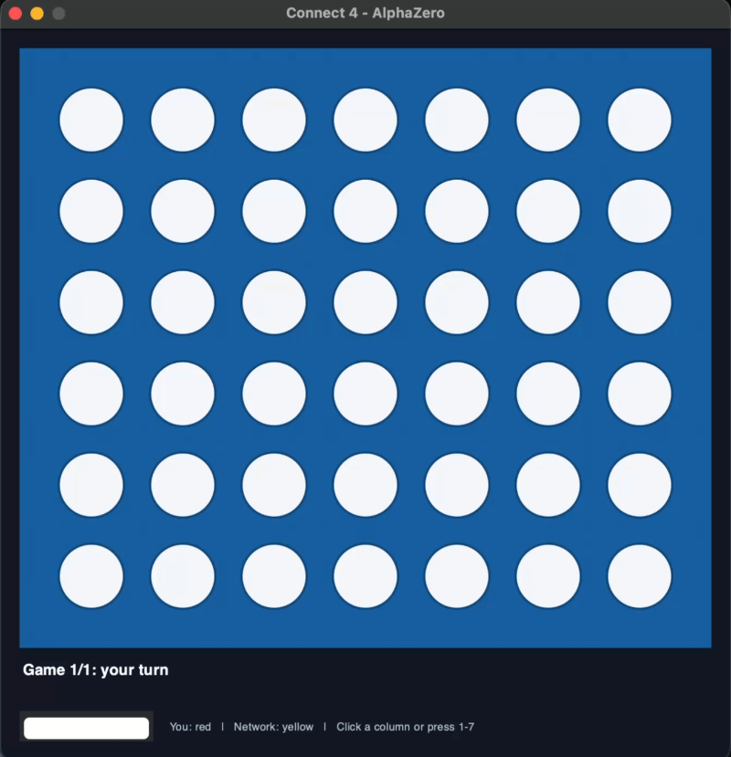
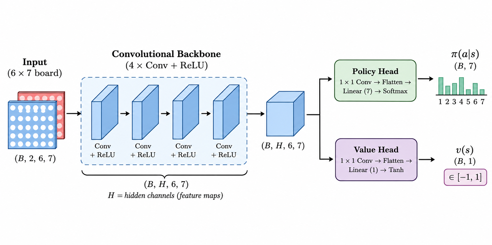

# AlphaZero on Connect-4 from Scratch

Built a complete AlphaZero-style agent for Connect-4, from the bare game rules to a self-play training loop that pits a policy-value network guided by PUCT Monte Carlo Tree Search against itself. Implemented the board engine, neural network, MCTS, self-play data generation, training, and evaluation against baselines.



*Network playing (and winning) against a human expert (me lol), with 50 MCTS simulation steps, and the policy decision distribution shown after each move.*

## How to run

```bash
python train.py --hidden_channels 24 --batch_size 8 --num_simulations 200 --num_games 50 --num_iterations 50 --num_epochs 10
```

To play against the included trained network with the graphical interface:

```bash
python play_connect4.py
```

The board accepts mouse clicks or the number keys `1` through `7`. Pieces
animate into place, and the network's selected column and policy probabilities
are shown while it decides.

After training a different network, pass its checkpoint and architecture:

```bash
python play_connect4.py --checkpoint path/to/network.pth --hidden_channels 24 --num_simulations 100 
```

The graphical evaluator is also available from `train.py --evaluate_mode human`
after a training run.

## Underlying Concepts

Connect 4 is a two-player game played on a 6-row, 7-column grid, with players alternating turns dropping pieces into columns. The first player to connect four of their pieces in a row (horizontally, vertically, or diagonally) wins. If the board fills up without a winner, the game is a draw. This can be modelled as a zero-sum game, making it suitable for reinforcement learning.

Following the framework of AlphaZero, we can use Monte Carlo Tree Search (MCTS) to simulate games and determine the best actions that lead to a win. MCTS has 3 main steps:
1. **Selection**: Starting from the root node, select child nodes based on a balance of exploration and exploitation until reaching a leaf node. Nodes are scored using both factors, written as Score(s, a) = Q(s, a) + U(s, a), where Q is the expected reward of the node and U is an exploration term that encourages promising or less-visited nodes to be explored.
2. **Expansion & Evaluation**: If the leaf node is not terminal (winning/losing/drawing state), expand it by adding all possible child nodes (legal moves). Evaluate the new leaf nodes to estimate their value in terms of how likely they are to lead to a win.
3. **Backpropagation**: Update the value estimates of all nodes along the path from the leaf node back to the root based on the evaluation results.

A couple of key questions arise when attempting to apply MCTS to Connect 4:
1. How do we actually evaluate the leaf nodes to determine their value? Do we need to simulate the game to the end and then make some estimate for that node? That could get really expensive if we abstracted this to a more complex game like chess or go where there are way more possible moves.
2. With the wide range of possible moves and state space, how do we ensure that our MCTS is efficient and doesn't waste time exploring unpromising branches of the tree? I'd want to have my algorithm be able to beat me as fast as possible, and that means making sure it doesn't even consider bad moves.

The **Predictor Upper Confidence Bounds applied to Trees (PUCT)** algorithm is a solution to both of these problems. Building on the scoring function from MCTS for the selection step, PUCT selects a child action a at state s that maximizes the following score:

$$Score(s, a) = Q(s, a) + U(s, a)$$
$$Score(s, a) = Q(s, a) + c_{puct} * P(s, a) * \frac{\sqrt{N(s)}}{1 + N(s, a)}$$

Where:
- Q(s, a) is the expected reward of taking action a at state s, based on the average of the values of all simulations that have passed through this node.
- U(s, a) is an exploration term that encourages the selection of less-visited nodes, where c_puct is a hyperparameter that controls the balance between exploration and exploitation, P(s, a) is the prior probability of taking action a at state s, and N(s) is the total number of times the parent node has been visited, while N(s, a) is the number of times action a has been taken from state s.

To compute Q(s, a), we can train a value network that takes the current board state as input and outputs a scalar value representing the expected outcome of the game from that state (-1 for a loss, 0 for a draw, and +1 for a win). Regular L2 loss can be used to train the value network, comparing predicted values to the actual values obtained by simulated self-play games (tracking the outcome of each game and assigning the appropriate value target to each state visited during the game).

To compute P(s, a), we can train a policy network that takes the current board state as input and outputs a probability distribution over all possible actions (for our case, columns 0-6 to drop a piece into). The policy network can be trained using cross-entropy loss, comparing predicted distribution to the actual distribution obtained by computing the visit count distribution of actions from the MCTS simulations per state. Thus, the visit count distribution can be normalized to form a probability distribution, which serves as the target for the policy network.

One can observe that the policy network is improved with more accurate visit count distributions from MCTS, while the value network is improved with more accurate value targets from self-play games. This creates a feedback loop where the policy and value networks improve each other over time, leading to stronger play. Hence, these networks are combined into a single policy-value network that outputs both the action probabilities and the value estimate for a given board state.

## Network Architecture & Training

While further testing and tuning of the network architecture is possible, my current best implementation uses a small convolutional neural network backbone with 4 convolutional layers, each followed by a ReLU activation function. The latents from the backbone are then fed into two seperate MLPs, one for the policy head, outputting a probability distribution over the 7 possible actions, and one for the value head, outputting a scalar value representing the expected outcome of the game from that state.
Note that a 1D convolutional layer is used at the start of each head to reduce the number of channels from the backbone output to the desired number of channels for each head. The policy head uses a softmax activation function to produce a valid probability distribution over actions, while the value head uses a tanh activation function to produce a scalar value in the range [-1, 1].



During training, I found that the most impactful hyperparameters to tune were the number of MCTS simulations per move and the number of games per iteration. This is because more simulations per move allows the MCTS to explore the game tree more thoroughly, producing a more accurate visit count distribution for the policy network to learn from. Similarly, more games per iteration allows the networks to learn from a larger and more diverse set of game states, improving their generalization and performance.

One challenge I faced during training was the tendency of the network to not make the right moves during terminal board states, where a player is about to win or lose. My goal was to have the network be strong enough to handle these situations using 50 MCTS simulations per move. To reach this goal, I needed to implement the use of Dirichlet noise during the MCTS simulations (also used in AlphaZero), which updates the prior probabilities of the child nodes at the root of the search tree to encourage exploration of less-visited nodes. This helps prevent the network from getting stuck in local optima and allows it to discover better moves during training. Dirichlet noise is formulated as follows:

$$P'(s, a) = (1 - \epsilon) * P(s, a) + \epsilon * n(a)$

Where:
- P'(s, a) is the updated prior probability of taking action a at state s
- P(s, a) is the original prior probability of taking action a at state s, computed by the policy network
- n(a) is a sample from a Dirichlet distribution with parameter alpha, which is set as a hyperparameter to control the amount of noise added to the prior probabilities
- epsilon is a hyperparameter that controls the balance between the original prior probabilities and the added noise, with a higher value of epsilon leading to more exploration of less-visited nodes. This is set to 0.25 in my implementation, following the AlphaZero paper.

In parallel to the use of Dirichlet noise, I also including random action sampling at the beginning of each game during self-play, where the first set of moves are selected randomly from the available legal moves, but still weighted by the policy network's prior probabilities. This helps to further encourage exploration of the game tree and prevent the network from getting stuck in local optima during training. I found that with these two techniques, the training data became much more diverse and the network, which was likely overfitting to a single strategy, was able to learn a more robust and generalizable policy, and thus make the right moves during terminal board states.

## Experiments and Evaluation

To evaluate the performance of the trained policy-value network during hyperparameter tuning, the network is pitted against various levels of opponents to rank its performance. The opponents include:
- Random: A baseline opponent that selects moves uniformly at random from the available legal moves. Network plays greedy, meaning it does not use MCTS to select moves, but instead selects the move with the highest probability from the policy network.
- Other Trained Networks: Networks trained with different hyperparameter settings, allowing for comparison of performance across different configurations and tournament-style ranking of networks based on their win rates against each other.
- Human: A human player, allowing for evaluation of the network's performance against a real opponent. The human player can select moves using the graphical interface, and the network plays with a defined number of MCTS simulations per move (the lower number of simulations, while still remaining strong, the better the network is).
- LLM: Using Ollama to run Qwen-3.5-9B on an M3 MacBook Pro, with custom system and user prompts to play Connect 4 with its own move history. The LLM is prompted to select moves based on the current board state, and the network plays with a defined number of MCTS simulations per move. The LLM is also prompted to provide reasoning for its move selection, allowing for evaluation of its decision-making process.

The best trained network with 50 MCTS simulations per move achieved a win rate of 90\% out of 20 games against a human expert (myself), and a win rate of 100\% out of 20 games against Qwen-3.5-9B with 50 MCTS simulations per move. The LLM was able to select winning moves in some cases, but was not able to consistently block the network's winning moves due to its inability to search future game states and evaluate the consequences of it and its opponeent's actions. An example of the prompts used and LLM reasoning for its move selection can be found in the `logs/prompts.log` file, and the full game logs can be found in the `logs/game.log` file. This emphasizes that even with enough context, simply throwing LLMs at a problem is not enough to achieve strong performance at a task, but rather, algorithmic approaches combined with other types of trained networks, especially cheaper and more efficient ones, can be more effective in solving the problem. This is especially true for problems with large search spaces, where LLMs alone are not able to search the space effectively and efficiently, and thus cannot make optimal decisions.

The effects of number of MCTS simulations per move on the network's performance is apparent when increasing to 100 or more, as the win rate against human players increases to 100\%. This is expected as the network's losses with 50 simulations were consistently due to missed terminal state blocking moves, which the network couldn't completely compensate for with that number of simulated visits.

